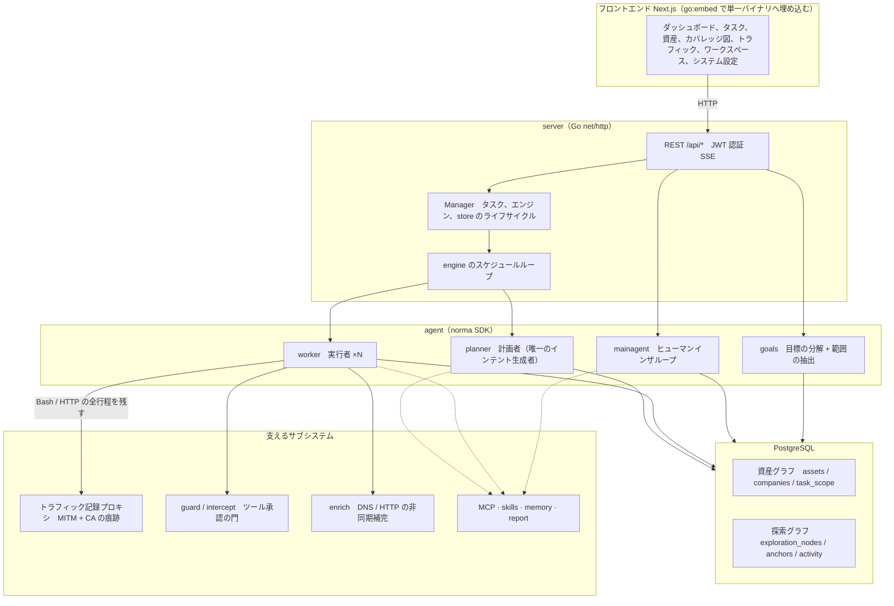
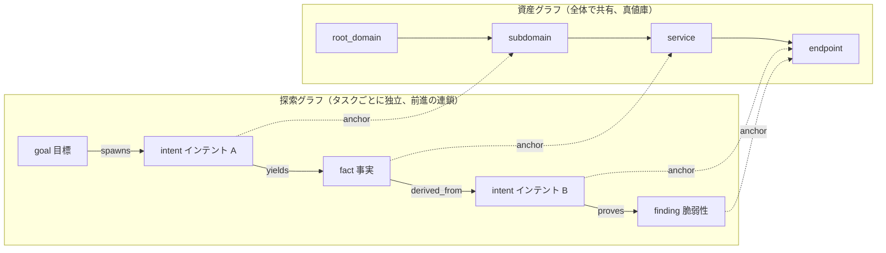
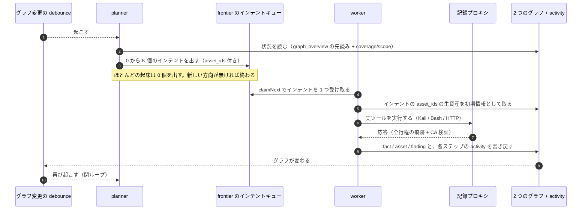
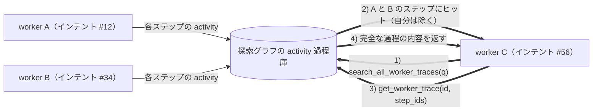
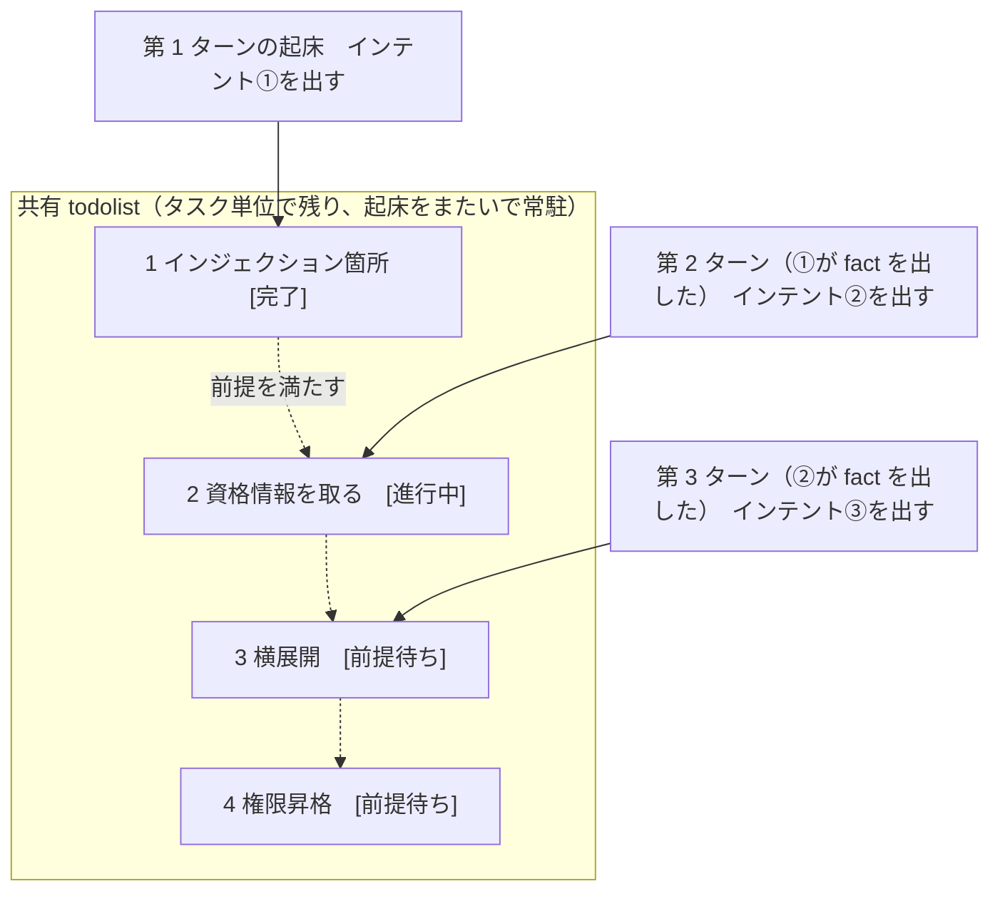

<div align="center">

# ARTEX

> **Archived upstream README.** This describes the upstream project and its
> prebuilt-image deployment. Do not follow its Docker or installer instructions
> in this fork. Use [`README.md`](README.md) instead.

AI による自律型ペネトレーションテストシステム（Go バックエンド + Next.js フロントエンド）


🌐 **オンライン Demo**: [https://artex-demo.vercel.app/](https://artex-demo.vercel.app/)

</div>

このリポジトリは独立して保守する [RuoJi6/ARTEX](https://github.com/RuoJi6/ARTEX) です。ARTEX の元のコミット履歴と AGPL-3.0 ライセンスを残しています。プログラムのリリースパッケージはこのリポジトリの Releases からダウンロードします。Docker イメージ [ruoji6/artex](https://hub.docker.com/r/ruoji6/artex) は、このリポジトリの GitHub Actions がビルドして公開します。

---

## スクリーンショット

> 操作全体は[オンライン Demo](https://artex-demo.vercel.app/)を見てください。

| ダッシュボード（総覧、Token 消費、アクティビティ） | タスク一覧 |
| :---: | :---: |
|  |  |

| タスクの実行過程（セッション、ツール呼び出し） | 探索経路 |
| :---: | :---: |
|  |  |

| 検出事項 | 資産 |
| :---: | :---: |
|  |  |

| 資産カバレッジ図（力学モデルのレイアウト、テスト済みの強調、ノードの折りたたみと展開） |
| :---: |
|  |

| トラフィック記録 | ヒューマンインザループの対話 |
| :---: | :---: |
|  |  |

| Agent 管理 | LLM 設定 |
| :---: | :---: |
|  |  |

| インターセプトの承認 | バックエンドログ |
| :---: | :---: |
|  |  |


---

## 承認記録の詳細

全体の「承認記録」、タスク内の「インターセプト承認」、対話中の承認カードは、どれも展開して詳細を見られます。表示の構造は
[AegisHook の承認詳細コンポーネント](https://github.com/RuoJi6/AegisHook/blob/main/web/src/components/CallDetail.vue)を参考にし、ARTEX のコンポーネントとテーマを使います。


## 資産同期（ScopeSentry）

[ScopeSentry](https://github.com/Autumn-27/ScopeSentry) から資産データを直接同期でき、集め直しを省けます。

- 「**資産同期**」ページに ScopeSentry のアドレスと API Key を入れ、データソースを接続します。
- **プロジェクト**または**タスク**の単位で、同期する目標と資産の種類（ドメイン、サブドメイン、IP、ポート、サイト、エンドポイントなど）を選びます。
- まとめて取り込み、企業の資産範囲へ寄せ、ARTEX の資産グラフへ入れて agent の探索に使います。

---

## インストール

> データベースは **PostgreSQL** が必要です。探索には **LLM** の設定が必要です（`ANTHROPIC_API_KEY` または `OPENAI_API_KEY`。UI でも設定できます）。

### 方法 1: ワンクリックインストールスクリプト（推奨）

```bash
git clone https://github.com/RuoJi6/ARTEX.git
cd ARTEX
./install.sh
```

スクリプトは Docker の有無を見て、無ければ自動で入れ、**① すべて Docker** か **② ローカルでコンパイルして実行** を選ばせます。

- **① すべて Docker**: Postgres のパスワードを 1 つ入れる（Enter だけならランダム）と、`.env` を書き、`docker compose up -d` します。
- **② ローカル実行**: データベースを選ぶ（既存へ接続するか、Docker で 1 つ立てる）と、`config.json` を作り、`go` でフロントエンドを埋め込んだ単一バイナリをコンパイルして起動します。

起動後は **http://localhost:8787** を開きます（初回は `/setup` で管理者パスワードを設定します）。

### 方法 2: Docker Compose（手動）

```bash
git clone https://github.com/RuoJi6/ARTEX.git
cd ARTEX
cp .env.example .env          # POSTGRES_PASSWORD を入れ、任意で ANTHROPIC_API_KEY
docker compose up -d          # ruoji6/artex イメージと postgres を取得する
# → http://localhost:8787
```

イメージには常用ツール（ripgrep、curl、vim、npm、nmap など）が入っています。`./skills` と `./data` はバインドマウントで残します。

`.env` の既定は `ARTEX_IMAGE=ruoji6/artex` です。`ARTEX_TAG=latest` は最新イメージを使い、`v0.3.15` に固定することもできます（完全なイメージアドレスは `ruoji6/artex:v0.3.15`）。イメージは `linux/amd64` と `linux/arm64` に対応し、Docker がホストに合うアーキテクチャを自動で選びます。ARM64 Kali を自分でコンパイルする必要はありません。初回デプロイでは `POSTGRES_PASSWORD` を変えてください。サービスを動かすのに Docker Hub の公開 Token は不要です。

リモート MCP は、システム設定で `http`（Streamable HTTP）または `sse`（旧 SSE）を選べます。
旧 SSE のサービスは、通常 `GET /sse` でイベントストリームを張り、サービスが返した
`/message?sessionId=...` で JSON-RPC リクエストを受けます。設定する URL は `/sse` にし、リクエストヘッダは
`Authorization=Bearer <token>` の形で入れます。

### 方法 3: ビルド済みバイナリをダウンロードする（Releases）

このリポジトリの [Releases](https://github.com/RuoJi6/ARTEX/releases) から、プラットフォームに合う zip をダウンロードして展開すると、`artex`、`start.sh`（Windows は `start.bat`）、`skills/`、`config.example.json` が得られます。Linux ARM64（ARM64 Kali を含む）は `linux-arm64`、x86_64 は `linux-amd64` を選びます。

```bash
cp config.example.json config.json   # database 接続を入れる
./start.sh                           # → http://localhost:8787
```

> `./artex` を直接実行せず、`start.sh` か `start.bat` で起動してください。これは常駐スクリプトで、プログラム終了後の終了コードで再起動するかを決め、**画面の[ワンクリックアップデート](#方法-1-ページのワンクリックアップデート推奨)はこれで入れ替えを終えます**。`./artex` を直接実行すると、アップデート後に起動されません。
> バックグラウンド常駐は `nohup ./start.sh >artex.log 2>&1 &` です。

### 方法 4: ソースから単一バイナリをコンパイルする

```bash
# 1) フロントエンドの静的エクスポート
cd web && npm ci && npm run build:static && cd ..
# 2) 埋め込みディレクトリへコピーする
cp -r web/out server/webui/dist
# 3) コンパイルする（-tags embedui のときだけフロントエンドを埋め込む）
CGO_ENABLED=0 go build -tags embedui -o artex ./cmd/artex
./start.sh
```

### 方法 5: クロスプラットフォームの Release 圧縮パッケージを作る

`build.sh` は先にフロントエンドをビルドして埋め込み、Go linker でデバッグ情報を除き、公開ファイルを zip に圧縮します。Release モードは既定で、Linux amd64 と arm64、macOS amd64 と arm64、Windows amd64 の zip を作ります。

```bash
./build.sh --release
# 生成物: dist/artex-0.3.3-*.zip
```

UPX の自己展開バイナリは、一部の Linux カーネル、仮想化環境、セキュリティポリシーと合わないことがあるため、既定では使いません。`ARTEX_TARGETS` で対象を指定できます。対象の実行環境が対応していると確認できたときは、`--upx` を明示してバイナリをさらに小さくできます。

```bash
ARTEX_TARGETS=linux/amd64,windows/amd64 ./build.sh --release
./build.sh --target linux/amd64 --upx
```

---

## アップデート

> アップデートはプログラムだけを替え、データは動かしません。Postgres のデータボリューム `pgdata`、`./data`（jwt.key、SQLite など）、`./skills` は残ります。**データベース移行を手で実行する必要はありません**。`artex` は起動のたびに `schema.sql` を冪等に再実行します（`ADD COLUMN` と `CREATE INDEX IF NOT EXISTS` を含みます）。つまり再起動が移行です。アップデート前に `./data` とデータベースのバックアップを推奨します。

### 方法 1: ページのワンクリックアップデート（推奨）

**システム設定**ページ（サイドバーの「システム設定」、`/system/settings`）の**バージョンとアップデート**カードで、サーバーへログインせずに新しいバージョンを確認してインストールできます。

このリポジトリがビルドしたプログラムは、`RuoJi6/ARTEX` の最新の正式 GitHub Release から更新を確認し、ドラフトとプレリリースは飛ばします。古い公式プログラムは元作者のリポジトリをまだ指すため、最初の切り替えは、このリポジトリがビルドしたプログラムを手で入れる必要があります。以後、より高い 3 桁バージョンを公開すれば、ページからアップデートできます。main や Git タグを push しただけで Release を公開していない場合、オンラインでインストールできる新しいバージョンは出ません。

「更新」を押すと、現在のプラットフォームのリリースパッケージをダウンロードし、Release の `SHA256SUMS` と照合し、`-h` で新しいバイナリのスモークテストをし、`artex.new` として仮置きし、プログラムが終了します。`start.sh` または `start.bat` が再起動して入れ替えを終えます。ページは新しいバージョンが上がるまで待ってから再読み込みします。

- **失敗しても壊れたプログラムは残りません**。検証かスモークが通らなければ仮置きを捨て、現在のバージョンを動かし続けます。入れ替え後の新版が 3 回連続で起動に失敗すると、`artex.old` へ自動ロールバックします（失敗したものは調査用に `artex.failed` として残します）。
- **いつでも戻せます**。前のバージョンは `artex.old` として残り、カードに「前のバージョンへロールバック」があります。データベース構造は戻りません。
- **アップデートは実行中のタスクを中断します**。アップデートは再起動なので、空いているときに行ってください。
- **開発ビルドにはアップデートを出しません**。バージョンが `dev`、または `git describe` に接尾辞があるときは無効にし、正式版がローカルデバッグのバイナリを上書きしないようにします。
- **Docker ではプログラムだけを替え、イメージは替えません**。イメージ内の playwright や nmap などのツールチェーンは一緒に上がらず、`docker compose up -d` でコンテナを作り直すとイメージ同梱のバージョンへ戻ります。イメージごと上げるときは `docker compose pull artex && docker compose up -d artex` を使ってください。
- GitHub へのアクセスにプロキシが必要なときは、同じページで**グローバルプロキシ**を設定すれば、更新経路はそれを通ります。更新は GitHub のドメインからだけダウンロードし、HTTPS を強制します。

### 保守者: GitHub Actions でオンライン更新を公開する

公開ワークフローは `.github/workflows/release.yml` です。正式タグの push でビルドが始まります。Actions、release、Run workflow で、すでに存在するタグを入れて、失敗した公開を再実行することもできます。タグは `vメジャー.マイナー.パッチ` でなければなりません。下の例は `v0.3.15` です。後続のバージョンは、ユーザーが動かしているバージョンより高くなければなりません。

```bash
git push origin main
git tag v0.3.15
git push origin v0.3.15
```

ワークフローはタグに対応するコミットを固定し、Node.js 22 でフロントエンドをエクスポートし、`go.mod` が指定する Go のバージョンでフロントエンドを埋め込んだ 5 プラットフォームのプログラムをコンパイルし、ZIP と `SHA256SUMS` を作ります。AMD64 と ARM64 のイメージは、それぞれ GitHub のネイティブ runner でビルドし、一時 PostgreSQL へ接続して、プログラムの起動、バージョン、埋め込みフロントエンドを検証します。両方のアーキテクチャが通ったあと、マルチアーキテクチャイメージのバージョンタグと `latest` を公開します。イメージの公開が成功してから完全な ZIP と検証ファイルをアップロードし、最後に Release を公開します。すでに公開した同じバージョンは上書きできません。新しいタグを出してください。

保守者は、このリポジトリの Settings、Secrets and variables、Actions で、変数 `ARTEX_DOCKER_IMAGE`（Docker Hub のユーザー名とイメージ名）と Secrets `DOCKERHUB_USERNAME`、`DOCKERHUB_TOKEN`（イメージの push 権限）を設定する必要があります。プログラムパッケージは GitHub 同梱の `GITHUB_TOKEN` でアップロードし、イメージは上の資格情報で Docker Hub へ push します。資格情報はワークフローのログインにだけ使い、ソースにもイメージにも書きません。イメージアドレスは `.env.example` と Compose の既定値にも記録します。

### 既存の Docker デプロイをこのリポジトリのイメージへ移す

元のデプロイディレクトリで `.env`、Compose ファイル、`data/`、PostgreSQL データをバックアップし、元のデータベースボリュームと skills のマウントは残します。`.env` の `ARTEX_IMAGE` をこのリポジトリのイメージアドレスに、`ARTEX_TAG` を対象バージョンにします。古い Compose が元作者のイメージを直書きしている場合は、次の上書きファイルを作れます（上書きファイルがすでにあるときは image の設定をマージしてください）。

```yaml
# docker-compose.override.yml
services:
  artex:
    image: ${ARTEX_IMAGE}:${ARTEX_TAG:-latest}
```

そのあとアプリケーションコンテナだけを更新します。

```bash
docker compose pull artex
docker compose up -d --no-deps artex
curl --fail http://127.0.0.1:8787/api/health
docker compose logs --tail=50 artex
```

元のデプロイディレクトリと Compose プロジェクト名を使い続け、`./data`、`./skills`、PostgreSQL のデータボリュームが元データを指したままにしてください。移行後、プログラムは `RuoJi6/ARTEX` からオンライン更新を確認します。以後はページでプログラムを更新するか、上のコマンドでイメージ全体を更新できます。

既存の Docker デプロイを初めて移すときは、検証済みの新しい ARM64 ZIP をホストで展開し、元のプログラムをバックアップしてから、既存コンテナの `/app/artex` だけを置き換えます。たとえば既存コンテナ名が `artex-artex-1` のときです。

```bash
# ダウンロードディレクトリで実行する。先に SHA256SUMS でダウンロードした ZIP を照合し、そのあと展開する。
sha256sum --ignore-missing --check SHA256SUMS
unzip artex-0.3.15-linux-arm64.zip
sudo docker stop artex-artex-1
sudo docker cp artex-artex-1:/app/artex ./artex-before-migration
sudo docker cp ./artex-0.3.15-linux-arm64/artex artex-artex-1:/app/artex
sudo docker start artex-artex-1
curl --fail http://127.0.0.1:8787/api/health
```

これで既存のデータベース、data、skills のマウントは残ります。システム設定ページにログインし、更新元とバージョンを確認してください。コンテナ内で置き換えたプログラムはコンテナの書き込みレイヤに属するため、コンテナを削除または再作成すると置き換え結果は失われます。再作成が必要なときは、このリポジトリのプログラムを含むイメージを使ってください。プログラムのロールバックはデータベース移行を戻しません。アップデート前にデータベースと data をバックアップしてください。

### 方法 2: ワンクリック更新スクリプト

```bash
cd ARTEX
./update.sh
```

スクリプトは、任意で `git pull` して最新コードを取り、そのあと **① Docker 更新** か **② ローカルコンパイル更新** を選ばせます（`install.sh` と対応します）。

- **① Docker**: 対象イメージの tag を指定できます（Enter なら `.env` の `ARTEX_TAG` を使い、無ければ `latest`）。そのあと `docker compose pull`、`docker compose up -d` です（新しいイメージへ替えて再起動すると、自動で移行します）。
- **② ローカル**: フロントエンドの静的生成物を作り直し、`./artex` を再コンパイルします（終わったあとプロセスを再起動すると有効になります）。

### 方法 3: Docker Compose（手動）

```bash
cd ARTEX
git pull                       # compose とスクリプトを更新する（任意）
# バージョン指定: .env に ARTEX_TAG=v0.3.15 を置く。置かなければ latest
docker compose pull artex
docker compose up -d artex     # 新しいイメージへ替えて再起動し、schema を自動移行する
docker image prune -f          # 古いイメージを掃除する（任意）
```

### 方法 4: ビルド済みバイナリ（Releases）

[Releases](https://github.com/RuoJi6/ARTEX/releases) から新しいバージョンの zip をダウンロードし、古いプロセスを止めてから `artex` と `skills/` を上書きします（自分の `config.json` と `data/` は残します）。再起動すれば動きます。

```bash
cp -r <展開ディレクトリ>/skills ./ && cp <展開ディレクトリ>/artex ./
./start.sh
```

### 方法 5: ソースからコンパイルする

```bash
git pull
cd web && npm ci && npm run build:static && cd ..
cp -r web/out server/webui/dist
CGO_ENABLED=0 go build -tags embedui -o artex ./cmd/artex
# ./start.sh を再起動する
```

---

## 設定

**データベース**（`config.json`。環境変数 `ARTEX_PG_DSN` で上書きできます）:

```json
{
  "database": {
    "host": "127.0.0.1", "port": 5432,
    "user": "artex", "password": "yourpass",
    "dbname": "artex", "sslmode": "disable"
  }
}
```

**LLM**: `export ANTHROPIC_API_KEY=sk-...`（または `OPENAI_API_KEY`）。UI の「LLM 設定」ページにも書けます。
任意: `ARTEX_LLM_PROVIDER`、`ARTEX_LLM_MODEL`、`ARTEX_LLM_BASE_URL`、`ARTEX_LLM_PROXY`。

**同時実行**: タスクごとの work agent 数は「システム設定」で設定します（既定は 3）。

**よく使う引数**: `./start.sh -addr :8787 -proxy :8788`（`-addr` はフロントエンドと API、`-proxy` はトラフィック記録プロキシ）。起動スクリプトは引数をそのまま `artex` に渡します。

### リバースプロキシでのデプロイ（HTTPS、公開するのは 443 だけ）

フロントエンドと API および SSE は、同じバックエンドポート（既定 `:8787`）が出します。リアルタイムのアクティビティは既定で**同一オリジン**を使うため、**`NEXT_PUBLIC_SSE_BASE` の設定は不要**です。公開網は 443 だけを開け、8787 は内部網に残せます。

SSE は長時間接続で、継続して送ります。リバースプロキシは**バッファを切らなければなりません**。切らないと、ブラウザはつながるのにイベントを受け取れません（アクティビティが回り続けます）。Nginx の例です。

```nginx
server {
    listen 443 ssl;
    server_name your.domain.com;
    # ssl_certificate / ssl_certificate_key ...

    location / {
        proxy_pass http://127.0.0.1:8787;
        proxy_set_header Host $host;
        proxy_set_header X-Forwarded-Proto $scheme;

        # SSE で必要な項目: バッファを切る、長いタイムアウト、HTTP/1.1
        proxy_buffering off;
        proxy_cache off;
        proxy_read_timeout 3600s;
        proxy_http_version 1.1;
        proxy_set_header Connection "";
    }
}
```

> SSE をページと違うオリジン（独立したサブドメインなど）にする必要があるときだけ、**ビルド時**に `NEXT_PUBLIC_SSE_BASE` を設定します（この変数は `next build` のときに静的パッケージへ固まり、コンテナ実行時に後から設定しても効きません）。

---


## 開発

### 手動の脆弱性再テスト

タスク詳細の「再テスト」タブでは、このタスクの脆弱性をページングして選び、過去の結論と証拠を見て、手動で再テストを始められます。開始後も現在のタブを残し、回転アイコンと「再テスト中」を出します。修正を確認すると、脆弱性の状態を同時に更新します。

脆弱性一覧の各行の操作で「再テスト」を押すか、脆弱性詳細の「脆弱性の再テスト」で「再テストを開始」を押し、任意の修正バージョン、テスト条件、制限を入れると、システムは独立した再テスト Agent セッションを作り、開始後も現在のページを残します。一覧のフラット表示、タスク別グループ、資産ビューは、どれもこの入口に対応します。再テストの実行中は回転アイコンと「再テスト中」を出し、見るときは対応するセッションへ入り、終わると「再テスト」に戻ります。再テストに元のスキャンタスクの再起動は不要です。結論は「まだ再現できる」「修正済み」「確認できない」の 3 つです。各回の結論、証拠、セッションへのリンクは脆弱性詳細に残します。

新しいバックエンドは初回起動時に、編集できる「脆弱性の再テスト」（`retester`）Agent を用意します。Agent 管理でプロンプト、LLM、実行予算、ツールを設定できます。既定では、それに関連付けた LLM を使い、関連付けが無ければ全体で有効な設定を使います。再テストセッションが成功して終わり、結論が「修正済み」のとき、システムは脆弱性の対応状態を「修正済み」に変えます。実行中、失敗、停止、それ以外の結論では元の状態を残します。元の証拠とレポートは常に残します。状態のドロップダウンで「修正済み」を手で選ぶこともできます。同じ脆弱性の再テストが進行中のときは既存セッションを再利用し、停止、失敗、サービスの再起動のあとで再開できます。

この版の履歴は脆弱性詳細とセッションで見ます。脆弱性レポートのエクスポートやタスクアーカイブパッケージにはまだ入れていません。トラフィックパッケージとの自動関連付けもしていません。デモモードは、模擬だと明示した記録だけを作り、実目標へはリクエストしません。

### ローカルでの実行とテスト

```bash
./dev.sh    # バックエンド(:8787) + トラフィックプロキシ(:8788) + フロントエンド next dev(:5173) → http://localhost:5173
```

- バックエンド: `go run ./cmd/artex`（`-tags embedui` が無いとフロントエンドは埋め込みません）
- フロントエンド: `cd web && npm run dev`（`/api` をバックエンドへリバースプロキシし、ホットリロード付き）
- テスト: `go test ./...`
- Mock プレビュー（バックエンド無し）: `cd web && NEXT_PUBLIC_MOCK=1 npm run dev`

---

## システムの技術構成

ARTEX は **LLM の複数 agent が動かす自律型ペネトレーションシステム**です。Go の単一バックエンド（Next.js フロントエンドを埋め込む）と PostgreSQL で、agent の能力は [`norma`](https://github.com/Autumn-27/norma) SDK が提供します（`agentcore`、`tool`、`permission`、`harness`、`memory`、`transcript`）。中心は**2 つのグラフ**と、その周りの 2 つの自律の仕組みです。**worker 同士の過程レベルの情報交換**と、**planner が複数ターンで共有する todolist による、安定した攻撃経路**です。

### 全体の層



| 層 | 役割 |
| --- | --- |
| **フロントエンド** | Next.js の静的エクスポートを `go:embed` で単一バイナリへ埋め込む。タスク、資産、探索経路、カバレッジ図を可視化し、ヒューマンインザループの対話を出す |
| **server** | `net/http` のルート、JWT 認証、SSE。`Manager` がタスク、エンジン、DB store のライフサイクルを持つ |
| **engine** | タスクごとに `plannerLoop` が 1 つと、worker goroutine が N 個。インテントの受け取り、タイムアウト、一時停止、drain |
| **agent** | goals、planner、worker、mainagent。`ToolSet` が 2 つのグラフを LLM ツールとして出す |
| **db** | 2 つのグラフの Postgres への保存（pgx）。schema は `go:embed` とともに、起動のたびに冪等にテーブルを作る |
| **支える部分** | 記録型 MITM プロキシ、承認の門、非同期補完、MCP、スキル、記憶、レポート |

### 2 つのグラフ: 探索グラフと資産グラフ

システムは「**目標は何か**」と「**どこまで測ったか**」を、互いに独立し、アンカーでつながる 2 つのグラフに分けます。

- **資産グラフ（Asset Graph、全体で共有）**: タスクをまたいで 1 つの資産の真値庫です。ノードは `root_domain / subdomain / ip / service / app / endpoint` で、企業に属します。ドメインからサブドメイン、サービス、エンドポイントへの親子と、重複排除の key は、すべてプログラムが計算します。agent が出すのは生の情報だけです。
- **探索グラフ（Exploration Graph、タスクごとに独立）**: 1 回のタスクの「考えと前進」の過程です。ノードは `goal（目標）/ intent（インテント）/ fact（事実）/ finding（脆弱性）/ hint（ヒント）` で、`spawns / derived_from / yields / proves` などの辺で**系譜**につながり、「どの方向がどの事実から派生し、何を出したか」に答えます。
- **2 つのグラフはアンカーでつながります**: `exploration_anchors(node_id, asset_id)` がインテント、事実、脆弱性を具体的な資産へ留めます。探索の方向から、それが当たっている資産を見られ、ある資産から、このタスクでどのインテントが測り、どの事実を出したかを逆に引けます。これが**資産テストのカバレッジ**と**資産カバレッジ図**（範囲内の資産と、テスト済みの強調）を支えます。



> 分担です。**planner** は探索グラフの状況を読み、目標を判定し、まだ覆っていない新しい方向があるときだけ **インテント** を frontier へ出します。**worker** は **インテントを 1 つ**受け取り、実ツールで実行し、新しい資産、事実、脆弱性を 2 つのグラフへ書き戻して止まります。資産グラフは共有する事実で、探索グラフはタスクごとの前進の連鎖です。

### エンジンとインテントのライフサイクル（1 回の探索の閉ループ）

エンジンは**イベント駆動**の閉ループです。グラフが変わると planner を起こし、planner がインテントを出し、worker がインテントを受け取って実行し書き戻し、書き戻しが次のラウンドを起こします。目標が証明される（`prove_goal`）まで続きます。



### worker 同士の過程レベルの情報交換

深い探索では、価値のある観察（あるエラー、ある応答の断片、ある隠れたパラメータ）が 1 つの worker の**実行過程**に出ても、正式な fact には書かれないことがあります。同じ作業を繰り返さず、経路上の worker が互いの上に立てるよう、worker は**work をまたいで過程を検索**できます。

- `search_all_worker_traces(q)`: **このタスクのほかの work の実行過程**をキーワードで検索します（自分のこのインテントのステップは自動で除きます）。ヒットには `intent_id` が付きます。
- `list_worker_traces` と `get_worker_trace(intent_id, step_ids=[…])`: 先にどの work が走ったかを見て、そのあとある work の具体的な数ステップの完全な内容を取り、細部を交換します。

探索グラフに対応する fact がまだ無くても、後続の worker は他人の過程にあった観察を再利用できます。**情報は worker のあいだを「実行過程」の粒度で流れ**、境界は変わりません（各 worker は、自分が受け取ったそのインテントだけを行います）。



### planner が複数ターンで共有する todolist から、安定した攻撃経路へ

実際の攻撃経路は、**前後に依存する複数ステップの列**であることが多いです（インジェクション箇所を見つける、資格情報を取る、横展開する、権限を上げる）。これを一度に並列で出すと乱れます。そのため planner は、**タスク単位で残り、起床をまたいで共有する計画の todo（todolist）** を持ちます。

- planner はイベント駆動です。グラフが変わると起こされますが、**起床のたびにセッションは新しい**です。共有 todolist により、直列の利用連鎖を **1 回記録**し、その後の複数ターンで **依存に沿ってインテントを段階的に出す**ことができます。連鎖全体を 1 ターンで先に全部広げることはしません。
- 各ターンでは、「前提ステップが終わり、依存する fact がすでに存在する」次のステップにだけインテントを出し、進捗に合わせて一覧を更新します（fact で満たされたステップは完了にします）。



こうして攻撃経路は、「イベント駆動で、セッションは状態を持たない」環境でも **安定して進み、繰り返さず、順序を間違えません**。これが、ARTEX が複数ステップの利用連鎖を自律して歩き切れる要点です。

---

## 交流グループ

QR を読み取って WeChat 公式アカウント **SecSentry** をフォローし、公式アカウントのダイレクトメッセージからグループへ入れます。

<div align="center">


</div>

---
## 参考

https://github.com/oritera/Cairn


## ライセンスと免責

### オープンソースライセンス

このプロジェクトは **GNU Affero General Public License v3.0（AGPL-3.0）** で許諾します。完全な条項はリポジトリ直下の [LICENSE](LICENSE) です。

誰でもこのプロジェクトを自由に使い、改変し、配布できます。ただし**派生作品も同じく AGPL-3.0 でオープンソースにしなければなりません**。特に、**このプロジェクトを改変し、ネットワーク経由（オンラインサービスとしてのデプロイなど）でユーザーに提供する場合も、そのユーザーへ対応する完全なソースを公開しなければなりません**。

> ⚠️ **重要な注意**: オープンソースライセンス自体は、ソフトウェアの用途を制限しません。以下の「使用の制限」と「免責」は、作者が利用者へ追加で置く約束と明示の声明です。必ず守ってください。

**ARTEX は個人の学習、コードの研究、ローカルでの技術検証に限ります。いかなるオンラインのシステムやサイトに対しても、実際のテストを始めてはなりません。**

### 許される使用範囲

- **このプロジェクトのソースを読み、学び、研究すること**と、**ローカルの隔離環境**で技術原理を検証することに限ります。
- 個人の学習、学術研究、コードレビューなど、攻撃ではない用途に使えます。

### 禁止事項

- **このツールで、いかなるサイト、オンラインサービス、ネットワーク接続されたシステムに対しても、スキャン、探査、利用、攻撃を始めてはなりません**（許可の有無、自前の資産かどうかを問いません）。
- このツールを、実際のペネトレーションテスト、攻防、本番環境に使ってはなりません。
- このツールを、違法な侵入、データの窃取、ランサム、サービス拒否、その他の破壊的または犯罪的な活動に使ってはなりません。
- このツールで、所在する国や地域の法令に反する行為をしてはなりません。

### 法令遵守の責任

利用者は、所在する国や地域の、ネットワークセキュリティ、データ保護、コンピュータ犯罪に関する法令のすべてを自分で守らなければなりません（中国本土では『サイバーセキュリティ法』『データ安全法』『個人情報保護法』および関連する司法解釈を含みますが、これらに限りません）。**このツールの使用から生じる法的責任と結果は、すべて利用者が負います。**

### 免責

このプロジェクトは「現状（AS IS）」で提供し、明示または黙示の保証を付けません。作者と貢献者は、このツールの使用（使い方が適切かどうかを問いません）から生じる直接または間接の損失、データの消失、システムの損傷、法的紛争について責任を負いません。**このプロジェクトをダウンロード、インストール、または使用した時点で、上の条項をすべて読み、理解し、同意したことになります。**
