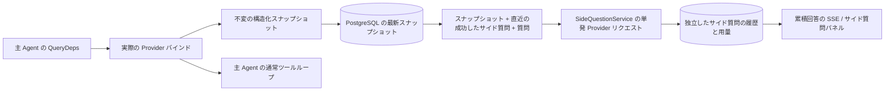

# ARTEX `/btw`

通常のチャット、タスクの MainAgent、そのタスク自身の Worker は、独立したサイド質問を受けます。主入力欄に `/btw 質問` と入れると送信できます。空の `/btw`、または「サイド質問」ボタンで履歴を開きます。デスクトップは幅を変えられるサイドバー、モバイルは Drawer です。

サイド質問の回答は、送信時点の Agent コンテキストのスナップショットから作ります。ストリーム表示、追問、停止、クリアができます。パネルを閉じる、ページを再読み込みする、SSE が切れる、のいずれでもモデルリクエストはキャンセルしません。停止が効くのは現在のサイド質問だけです。クリアはサイド質問をキャンセルして履歴を消し、主コンテキストのスナップショットは残します。

## 実装の境界

Go、norma v0.3.7、Next.js、既存の Markdown、ResizablePanel、Drawer、AlertDialog をそのまま使います。norma のソースは変えず、サイド質問用の依存も足しません。Planner、ほかのタスクから継承した Worker、ツール型サブタスクの昇格は、今回の範囲外です。

- `capture.go` は、`Options.Deps.CallModel / CallModelSync` のときだけ主ループのリクエストに印を付けます。Provider デコレータは具体モデルの内側、ルートプールの外側の選択のあとにあるため、実際に選ばれたモデルを記録します。圧縮と要約のリクエストはスナップショットを上書きしません。
- リクエスト開始、完全なモデル応答、実行の終態でスナップショットを公開します。生成途中の半分の応答は公開しません。ツール呼び出しは norma の `MessagesForAPI` でペアを保ち、ツール結果は次の主モデルリクエスト、または実行の終態でスナップショットに入ります。ストリーム中断は、直前の有効な境界を残します。
- スナップショットは JSON のディープコピーで、構造化メッセージ、システムプロンプト、ツール定義、生成パラメータを残します。モデル推論はスナップショットのロックもデータベーストランザクションも持ちません。
- `SideQuestionService` は具体 Provider を呼びます。必要なら先にサイド質問の要約を作り、最終回答は、初回のコンテキスト超過かつテキストもツール呼び出しもまだ出ていないときに限り、縮めたあと 1 回だけ再試行できます。agent session は作らず、ツール実行器、主 transcript、アクティビティストリーム、タスクグラフにもつながず、タスクのモデル切り替え連鎖も通りません。回答がツール定義を残すのは、既存の構造化ツールコンテキストとの互換のためです。要約リクエストはツールを渡しません。新しく返ったツール呼び出しに実行経路はありません。
- 親セッションごとに実行中リクエストは 1 つ、サービスプロセス全体で最大 4 つ、1 回のタイムアウトは 120 秒です。サイド質問は、サービスのライフサイクルにぶら下がる独立したキャンセルコンテキストを使います。
- サイド質問リクエストは、モデル設定への参照と、機微でない識別情報の要約を残します。リクエスト時に既存の設定から資格情報を取ります。設定が削除された、またはモデル、プロトコル、アドレスなどの識別フィールドが変わったときは、先に主 Agent を動かしてスナップショットを更新する必要があります。テストは製品の既定モデルを変えません。

## 永続化と復元

`db/schema.sql` が `side_question_sessions` と `side_question_requests` を自動作成します。前者は親リソース、最新スナップショット、実行番号、バージョン、クリアバージョンを保存します。後者は質問、累積回答、状態、モデル、スナップショット時刻、用量、イベント番号、ページ番号を保存します。

親セッションのキーは conversation ID、または task ID + exploration ID + intent ID です。Worker は再利用できる実行スロット名を使いません。

スナップショットは親セッション単位でまとめて書き、250 ms ごとにフラッシュします。データベースは `(run_id, version)` を比べ、古いバージョンが上書きするのを防ぎます。サイド質問の送信前に、選んだスナップショットをもう一度保存します。保存に成功したら、メモリ上の大きなスナップショットを解放します。失敗したときは、未書き込みのバージョンを残します。回答の累積内容は、ストリームイベントが来たとき最大 250 ms に 1 回書き、終態はすぐ保存し、データベースエラーでは限られた回数だけ再試行します。

サービス起動時、残っていた `running` リクエストを `interrupted` にします。すでに落ちている部分回答と用量は残し、リクエストを自動では再送しません。直近で保存に成功したコンテキストは、次の質問にそのまま使えます。古いセッションにスナップショットが無いときは、先に主 Agent を動かす必要があり、UI のアクティビティ記録からコンテキストを再構成しません。

クリアはクリアバージョンを増やしてリクエストを消します。条件付き更新が、遅れて届いたコールバックの書き戻しを止めます。物理的な親リソースの削除は外部キーのカスケードに任せます。Worker の論理削除は同じトランザクションでサイド質問データを消し、そのあとに遅れて来たスナップショットを拒否します。タスクアーカイブは、先に新しいリクエストを止め、主処理の停止を待ち、サイド質問をキャンセルして書き込みを待ちます。アーカイブ形式は v3 で、サイド質問テーブルの無い v1 と v2 も互換です。

履歴はすべて保存し、番号カーソルで 1 ページ最大 20 件を返します。モデルリクエストは、成功した直近 20 組の原文を上限に再生し、同時に token 予算で再生量を制限します。それより古い問答は、独立したローリング要約を持ちます。主コンテキストが予算を超えたときは、サイド質問の複製のうち古い部分だけを要約し、直近の構造化ツール呼び出しと結果は残します。要約、準備の進捗、用量は、サイド質問の同時実行、キャンセル、120 秒タイムアウトの制限に入ります。詳細は [コンテキスト予算とオープンソースの参照](CONTEXT_BUDGET.md) です。

## HTTP 契約

次のパスを `{parent}` とし、既存の認証とリソース検査を使います。

- `/api/conversations/{id}`
- `/api/tasks/{id}/chat`
- `/api/tasks/{id}/intents/{iid}`

| リクエスト | 戻り値と振る舞い |
| --- | --- |
| `GET {parent}/side-questions?before={ordinal}` | `items` は新しい順。独立した `current` の実行状態、`snapshot` のメタ情報、`next_cursor`。カーソル 0 は最新ページ、または次ページ無し |
| `POST {parent}/side-questions` | JSON `{ "question": "…", "client_request_id": "UUID" }`。新規は 202 とリクエストオブジェクト。同じ ID と同じ質問は既存オブジェクトを 200 で返す |
| `DELETE {parent}/side-questions` | 現在の親セッションのサイド質問をキャンセルして空にする |
| `GET /api/side-questions/{requestID}/events` | `snapshot` の SSE イベント。`id` は増加する番号。`data` は累積した完全なリクエストオブジェクト。クリア時は `cleared` を送る |
| `POST /api/side-questions/{requestID}/cancel` | 明示的にキャンセルする。終態は履歴か SSE から読める |

質問の上限は 4000 文字です。スナップショットが無い、モデル設定が変わった、同じ親セッションが忙しい、冪等 ID が衝突した、のいずれかは 409 です。全体の同時実行上限は 429 です。SSE 接続のたびに、先に累積状態を送り、クライアントが以前受け取ったテキスト断片には依存しません。フロントエンドはリクエスト ID と番号でマージし、親セッションの切り替えとクリアのときに古いコールバックを捨てます。

## 検証と参照

自動チェック、実際のモデル利用、既知の制限は [VALIDATION.md](VALIDATION.md) にあります。

独立リクエストの参照は [Grok CLI side-question.ts（固定コミット）](https://github.com/superagent-ai/grok-cli/blob/fb97af83f06dca873281d60168430f06c8de6324/src/utils/side-question.ts)、実行の隔離の参照は [OpenCode（固定コミット）](https://github.com/anomalyco/opencode/tree/b3f1a96c6dd7adeb28b36dd11add1998fc84d67b) です。ARTEX のコンテキストは norma の構造化メッセージを使い、フロントエンドのログをつなげてテキストにする方式は採っていません。
