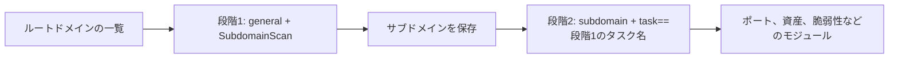

---

## name: scopesentry-mcp
description: ScopeSentry MCP でセキュリティスキャン基盤（プロジェクト、タスク、テンプレート、資産、ノード）を管理します。ユーザーが ScopeSentry、MCP、API Key、スキャンタスク、資産照会に触れたときに使います。

# ScopeSentry MCP の使い方

**すでにデプロイした ScopeSentry インスタンス**のユーザー向けです。Cursor（またはほかの MCP クライアント）から基盤へ接続し、ローカルのソースは不要です。

## 1. 準備

### 1.1 サービスへ到達できることを確認する

- 既定の Web 画面: `http://<ホスト>`
- MCP エンドポイント: `http://<ホスト>/mcp`（手前にリバースプロキシやフロントエンドプロキシがあるときは、実際の `/mcp` アドレスに合わせます）

### 1.2 API Key を作る

1. ブラウザで ScopeSentry の Web 画面へログインします
2. **API Key** の管理ページで鍵を作ります（または管理者が渡したインターフェースで作ります）
3. 返った `ssk_...` 文字列を保存します（**1 回しか表示しません**）

### 1.3 Cursor MCP を設定する

Cursor、Settings、MCP でサーバーを追加します。

```json
{
  "mcpServers": {
    "scopesentry": {
      "url": "http://<あなたのホスト>:8082/mcp",
      "headers": {
        "X-API-Key": "ssk_あなたの鍵"
      }
    }
  }
}
```

次でも使えます。`Authorization: Bearer ssk_あなたの鍵`

設定後、MCP を再起動するか Cursor を再読み込みし、ツール一覧に `list_projects` や `list_assets` が出ることを確認します。

---

## 2. ツール一覧


| ツール                     | 用途                |
| ---------------------- | ----------------- |
| `list_projects`        | タグでグループしたプロジェクトツリー（プロジェクト ID を含む） |
| `list_projects_data`   | ページングしたプロジェクト一覧。名前で検索できる     |
| `get_project`          | プロジェクトの詳細              |
| `create_project`       | プロジェクトの新規作成              |
| `list_tasks`           | スキャンタスクの一覧            |
| `get_task`             | タスクの詳細              |
| `list_scan_templates`  | スキャンテンプレートの一覧            |
| `get_scan_template`    | テンプレートの詳細              |
| `list_plugin_modules`  | スキャンパイプラインのモジュール名          |
| `list_plugins`         | 使えるプラグイン（hash と既定パラメータを含む） |
| `create_scan_template` | スキャンテンプレートの作成            |
| `create_scan_task`     | スキャンタスクの作成            |
| `list_assets`          | 各種資産の照会（ページング一覧）       |
| `count_assets`         | 資産数の集計（`/api/assets/common/total`） |
| `get_asset_detail`     | 資産または脆弱性の詳細           |
| `add_asset_tag`        | 資産へタグを付ける           |
| `list_nodes`           | スキャンノードの一覧            |


各ツールのパラメータは MCP のツール説明（schema）に従います。`list_assets` と `count_assets` の search と filter の文法は同じです。資産を照会する前に `list_assets` の description を読んでください。

「全部で何件か」を知るときは `count_assets` を使います（Web のページング総数のインターフェースに対応します）。総数を数えるために `list_assets` を繰り返しめくらなくて構いません。

---

## 3. よく使う手順

### 3.1 プロジェクトで資産を調べる

ユーザーまたは文脈に**すでにプロジェクト条件がある**ときは、先に `filter.project` を付けて範囲を狭め、プロジェクトをまたぐデータ過多で応答が遅くなるのを避けます。プロジェクトが明確でなければ、プロジェクト絞り込みを強制しません。

1. `list_projects` または `list_projects_data` で、対象プロジェクトの **ObjectID**（`id`、`children[].value`）を取ります
2. `list_assets` に `filter.project` を渡します（**ID でなければなりません。プロジェクトの中国語名は書けません**）

```json
{
  "asset_type": "asset",
  "pageIndex": 1,
  "pageSize": 20,
  "search": "domain=^example.com",
  "filter": {
    "project": ["<プロジェクトObjectID>"]
  }
}
```

### 3.2 スキャンタスクを作る

1. `list_nodes` でオンラインのノード名を取ります
2. `list_scan_templates` または `create_scan_template` でテンプレートの **ObjectID** を取ります
3. `create_scan_task` では `name` と `node` が必須です。`template` にはテンプレート ID を入れます（テンプレート名は入れられません）

**目標の出所 `targetSource`（Web 端と同じ）:**

| targetSource | 説明 | 必須パラメータ |
| --- | --- | --- |
| `general` | 目標を直接入力する | `target` |
| `project` | プロジェクトから目標を読む | `project`（プロジェクト ObjectID の配列） |
| `asset` | Web の資産庫を検索する | `search`。任意で `project`、`filter`、`targetNumber` |
| `RootDomain` | ルートドメイン庫を検索する | `search`。任意で `project`、`filter`、`targetNumber` |
| `subdomain` | サブドメイン庫を検索する | `search`。任意で `project`、`filter`、`targetNumber` |
| `UrlScan` | URL スキャン結果を検索する | `search`。任意で `project`、`filter`、`targetNumber` |
| `*Source`（例: `subdomainSource`） | 資産ページの「選択または検索」から作る | `targetTp=search` のときは `search`。`targetTp=select` のときは `targetIds` |

**例。ルートドメインを直接スキャンする:**

```json
{
  "name": "example-サブドメイン収集",
  "node": ["node-1"],
  "template": "<テンプレートObjectID>",
  "targetSource": "general",
  "target": "example.com\nfoo.com",
  "project": ["<プロジェクトObjectID>"]
}
```

**例。サブドメイン庫から続けてスキャンする（前のタスク名で絞る）:**

```json
{
  "name": "example-ポートと脆弱性",
  "node": ["node-1"],
  "template": "<後続モジュールのテンプレートObjectID>",
  "targetSource": "subdomain",
  "search": "task==\"example-サブドメイン収集\"",
  "project": ["<プロジェクトObjectID>"]
}
```

### 3.3 ルートドメインの完全な情報収集（2 段階を推奨）

入力が**ルートドメイン**で、**完全な情報収集**をするときは、2 回に分けてスキャンし、パイプラインを一度に全部走らせないことを勧めます。

**理由:** 分散タスクは**目標 1 件**を単位に配ります。ルートドメインを目標にすると、あるノードがそのルートドメインを受け取ったあと、そのノードで見つかったサブドメインも同じノードで後続モジュールを続け、負荷が偏り、遅くなり、失敗しやすくなります。

**推奨手順:**

1. **第 1 段階。サブドメイン収集だけ**
   - `targetSource`: `general`
   - `target`: すべてのルートドメイン（複数行）
   - テンプレート: `SubdomainScan` と `SubdomainSecurity` だけを有効にする（サブドメインスキャンとサブドメインテイクオーバー）
   - `get_task` でタスク完了を待つ

2. **第 2 段階。後続モジュール**
   - `targetSource`: `subdomain`
   - `search`: `task=="<第1段階のタスク名>"`（タスク名の完全一致）
   - 任意で `project` を付けて範囲を狭める
   - テンプレート: ポートスキャン、資産マッピング、脆弱性スキャンなど（SubdomainScan は無くてよい）
   - サブドメインを独立した目標として各ノードへ配り、並列の効率が上がります

Web 画面の「サブドメイン」資産ページでタスク名を絞り、「サブドメインからタスクを作成」しても同じ結果です。



### 3.4 スキャンテンプレートを作る

1. `list_plugin_modules` でモジュール名の一覧を取ります
2. `list_plugins`（`module` で絞れます）で、各プラグインの `hash` と既定の `parameter` を取ります
3. `create_scan_template` で、`modules` に「モジュールからプラグイン hash の配列」を指定します

---

## 4. 資産照会（`list_assets` / `count_assets`）

`count_assets` と `list_assets` は同じ `asset_type`、`search`、`filter` を使い、`{ "total": N }` を返します。Web 端の `/api/assets/common/total` に対応します。

```json
{
  "asset_type": "subdomain",
  "search": "task==\"あるタスク名\"",
  "filter": {"project": ["<プロジェクトObjectID>"]}
}
```

**性能の勧め（`list_assets` と `count_assets` に共通）:** プロジェクト条件があるときは先に `filter.project` で範囲を狭めます。`search` では、インデックスのあるフィールドにできる限り `==` の完全一致か `^` の前方一致を使います（[4.3](#43-search-検索式)）。広い `=` のあいまい検索は応答を遅くします。プロジェクトの文脈が無いときは、プロジェクト絞り込みを強制しません。

`filter.project` を使える型は [4.4](#44-filter-の厳密な絞り込み) の表です。

### 4.1 資産の型 `asset_type`

`asset`、`RootDomain`、`subdomain`、`app`、`mp`、`UrlScan`、`SensitiveResult`、`DirScanResult`、`crawler`、`vulnerability`、`PageMonitoring`、`IPAsset`、`SubdomainTakerResult`

別名の例: `web` は asset、`vuln` は vulnerability、`ip` は IPAsset、`url` は UrlScan

### 4.2 パラメータ


| パラメータ                       | 説明                                      |
| ------------------------ | --------------------------------------- |
| `pageIndex` / `pageSize` | ページング。既定は 1 / 20                            |
| `search`                 | 検索式（次の節）                              |
| `filter`                 | 厳密な絞り込みの JSON（次の節）                          |
| `sort`                   | UrlScan と DirScanResult だけが `length` で並べ替えできる |
| `sid`                    | SensitiveResult だけ。機微ルールの名前                |


`search` と `filter` は**同時に使えます**。

### 4.3 search の検索式

独自 DSL です（**SQL ではありません**）。


| 演算子  | 意味   | インデックス | 例                          |
| ---- | ---- | ---- | --------------------------- |
| `=`  | あいまい一致（regex） | インデックスを使わない | `domain=example`            |
| `==` | 厳密一致（完全一致） | **インデックスを使う** | `port==443`                 |
| `!=` | 除外   | — | `port!="80"`                |
| `&&` | かつ    | — | `domain==example.com && port==443` |
| `||` | または    | — | `title=admin || body=login` |


**インデックスと演算子:** `domain`、`ip`、`port`、`title` などのフィールドにはインデックスがありますが、**`==` の完全一致**、または **値が `^` で始まる前方一致**（例: `domain=^example.com`）だけがインデックスを使います。**`=` は regex のあいまい一致になり、インデックスを使えません**。データ量が多いと遅くなりやすいです。

**すべての型に共通の search フィールド:** `tag`、`task`（タスク名）、`rootDomain`

**project は search に書けません**（無効か、`&&` と組み合わせるとエラーになります）。プロジェクトの絞り込みは `filter.project` を使います。

**型ごとのよく使う search フィールド:**


| asset_type           | フィールド                                                                                  |
| -------------------- | ----------------------------------------------------------------------------------- |
| asset                | domain, ip, port, service, app, title, statuscode, icon, banner, type, body, header |
| RootDomain           | domain, icp, company                                                                |
| subdomain            | domain, ip, type, value                                                             |
| app                  | name, icp, company, category, description, url, apk                                 |
| mp                   | name, icp, company, category, description, url                                      |
| UrlScan              | url, input, source, resultId, type                                                  |
| SensitiveResult      | url, sname, body, info, md5                                                         |
| DirScanResult        | url, statuscode, redirect, length                                                   |
| vulnerability        | url, vulname, matched, request, response, level                                     |
| crawler              | url, method, body, resultId                                                         |
| PageMonitoring       | url, hash, diff, response                                                           |
| IPAsset              | ip, domain, port, service, webServer, app                                           |
| SubdomainTakerResult | domain, value, type, response                                                       |


**search の例:**

- `domain==www.example.com && port==443`（完全一致。インデックスを使う）
- `domain=^example.com`（前方一致。インデックスを使う）
- `ip==192.168.1.1`
- `task=="あるタスク名"`
- `level==high`（vulnerability）
- `statuscode==200`（DirScanResult）

あいまいに含む必要があるときだけ `=` を使います。例は `title=admin` です（インデックスを使わないので、プロジェクトなどの条件で範囲を狭めるのがよいです）。

### 4.4 filter の厳密な絞り込み

JSON オブジェクトです。同じ key の複数の値は **OR**、違う key は **AND** です。

**プロジェクト条件があるときは `project` を優先します。** ユーザーまたは文脈でプロジェクトが明確で、asset_type が `project` に対応するなら、範囲を狭めるために付けます。プロジェクト情報が無いときは強制しません。


| filter key   | 意味       | 値                                                     |
| ------------ | -------- | -------------------------------------------------------- |
| `project`    | 所属プロジェクト     | **ObjectID**。`list_projects` または `list_projects_data` で取る |
| `task`       | 出所のタスク     | **タスク名**。`list_tasks` の `name`                         |
| `port`       | ポート       | 例: `"443"`                                                |
| `service`    | サービスとプロトコル    | 例: `"https"`                                              |
| `app`        | アプリケーション指紋     | 例: `"Nginx"`                                              |
| `icon`       | アイコン hash  |                                                          |
| `statuscode` | HTTP ステータス | 主に asset                                               |
| `status`     | 状態       | UrlScan と DirScan の HTTP コード。脆弱性と機微情報の処理状態                       |
| `level`      | 脆弱性のレベル     | critical / high / medium / low / info                    |
| `type`       | 型       | 例: サブドメインレコードの型 A、CNAME                                         |
| `color`      | 機微ルールの色   | SensitiveResult                                          |
| `sname`      | 機微ルール名    | SensitiveResult                                          |
| `tags`       | タグ       |                                                          |


**型ごとに使える filter key:**


| asset_type                            | filter key                                                      |
| ------------------------------------- | --------------------------------------------------------------- |
| asset                                 | project, port, service, app, icon, statuscode, type, task, tags |
| RootDomain                            | project, tags                                                   |
| subdomain                             | project, type, task, tags                                       |
| app / mp                              | project, tags                                                   |
| UrlScan                               | status, tags                                                    |
| DirScanResult                         | status, tags                                                    |
| SensitiveResult                       | status, color, sname, tags                                      |
| crawler                               | project, task, tags                                             |
| vulnerability                         | project, level, status, task, tags                              |
| PageMonitoring / SubdomainTakerResult | tags                                                            |
| IPAsset                               | project, port, service, app                                     |


**filter の例:**

```json
{"project": ["<プロジェクトObjectID>"], "port": ["443"]}
```

**組み合わせ照会の例:**

```json
{
  "asset_type": "asset",
  "search": "domain=^baidu && port==443",
  "filter": {"project": ["<プロジェクトObjectID>"]},
  "pageIndex": 1,
  "pageSize": 10
}
```

**注意:**

- プロジェクト条件があるときは、対応していれば `filter.project` を優先して付けます。プロジェクトの文脈が無ければ強制しません
- `filter.project` にプロジェクトの表示名を入れないでください
- 既知の値は `==`、前方は `^` を使います。大きい表で `=` のあいまい一致を濫用しないでください
- UrlScan の HTTP 状態は `filter.status` です。DirScanResult は search で `statuscode==200` を使えます
- SensitiveResult をルール名で絞るときは、`search` の `sname=ルール名`、または `filter.sname` です

### 4.5 並び替え sort

**UrlScan** と **DirScanResult** だけが対応します。

```json
{"length": "ascending"}
```

ほかの型は `sort` を無視し、時刻の既定順です。

---

## 5. スキャンテンプレートのモジュール名

`TargetHandler`、`SubdomainScan`、`SubdomainSecurity`、`PortScanPreparation`、`PortScan`、`PortFingerprint`、`AssetMapping`、`AssetHandle`、`URLScan`、`WebCrawler`、`URLSecurity`、`DirScan`、`VulnerabilityScan`、`PassiveScan`

---

## 6. 切り分け


| 現象        | 対処                                                 |
| --------- | -------------------------------------------------- |
| MCP にツールが無い   | URL、API Key、ScopeSentry が動いているかを確認する                    |
| 401 / 403 | API Key を作り直すか、差し替える                                    |
| 資産が見つからない     | `filter.project` が ObjectID であることを確認する。search に project を書かない |
| テンプレートまたはタスクの作成に失敗 | `template` はテンプレート ObjectID でなければならない。`node` にはオンラインのノード名を入れる            |
| 照会がとても遅い、または止まる   | プロジェクトがあるときは `filter.project` を付ける。インデックスのあるフィールドの search は `==` か `^` の前方一致にし、`=` を減らす。`pageSize` を小さくする |


---
